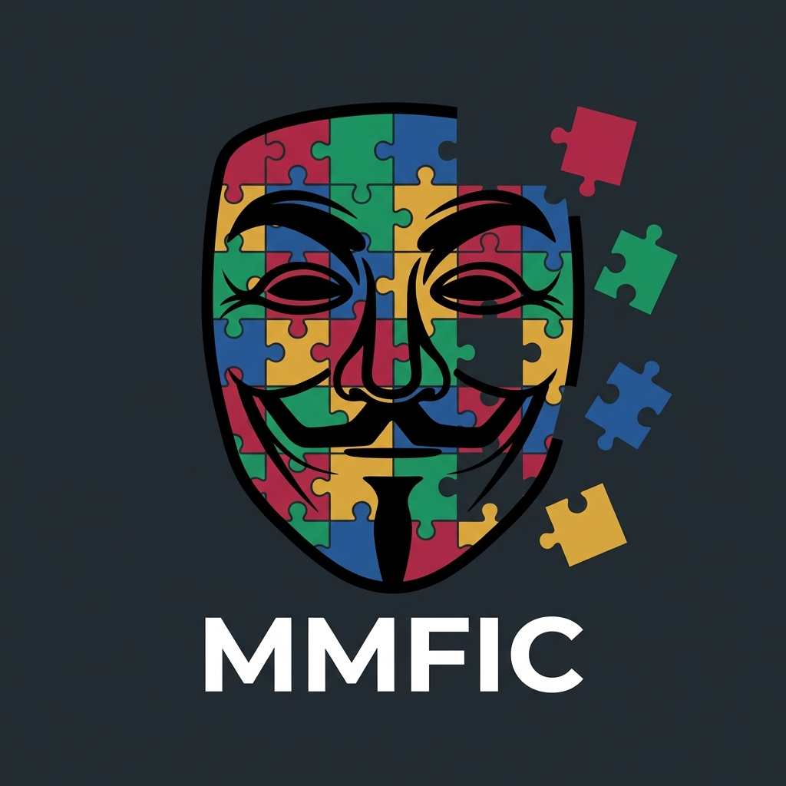
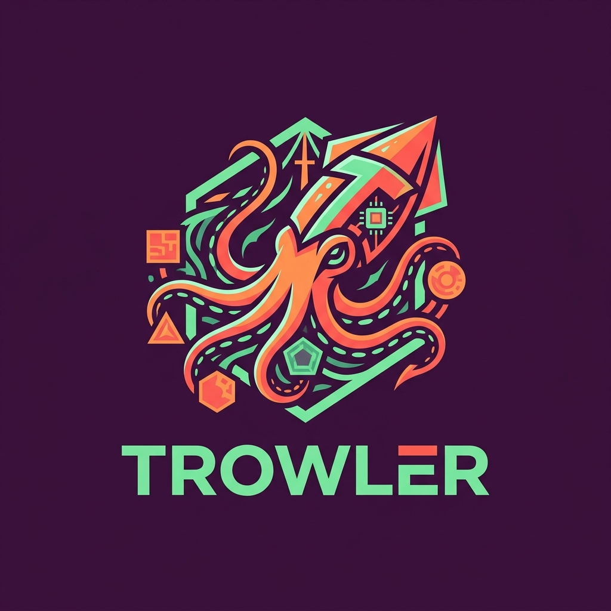

<p align="center">
  
</p>


# MMFIC: Multi-Modal Forum Identity Correlation Framework 

<<<<<<< HEAD
*Currently in Public Beta. See the [**Wiki**](https://github.com/TheFault666/MMFIC-Framework/wiki) for known issues and contribution guidelines.*

**MMFIC** (Multi-Modal Forum Identity Correlation) is a Open Source Intelligence (OSINT) framework designed to track, correlate, and unmask anonymous threat actors across heavily fortified Darkweb forums (.onion) and Clearnet platforms (like X/Twitter). 

The framework is divided into two primary subsystems:
1. **Trowler (Data Acquisition Engine):** A LLM-powered headless crawler built to bypass EndGame, DDoS-Guard, and strict login walls.
2. **The Similarity Engine:** A Machine Learning pipeline that extracts stylistic, linguistic, and behavioral metadata from crawled posts to correlate user pseudonyms across different platforms.

## Key Features
=======
<p align="center">
  
  &nbsp;&nbsp;&nbsp;&nbsp;
  
</p>

*Currently in Public Beta. See [WIKI.md](WIKI.md) for full architecture and REST API documentation, and [ROADMAP.md](ROADMAP.md) for development milestones.*

**MMFIC** (Multi-Modal Forum Identity Correlation) is an Open Source Intelligence (OSINT) framework designed to track, correlate, and attribute anonymous threat actors across fortified Darkweb forums (`.onion`) and Clearnet platforms (like X/Twitter). 

The framework is divided into two primary subsystems:
1. **Trowler (Data Acquisition Engine):** A Playwright-based Stealth browser crawler routed over Tor SOCKS5 (`socks5h` DNS isolation) with Human-in-the-Loop (HITL) CAPTCHA handling, multi-tier DOM extraction, and OPSEC-gated LLM schema discovery.
2. **MMFIC Similarity Engine (Attribution & Correlation):** A Machine Learning pipeline that builds 292-dimensional linguistic, behavioral, temporal, and topical author fingerprints stored in SQLite (`Forum_profiles.db`) and scores cross-forum identity pairs using LightGBM with a Three-Way Decision tie-breaker.

---

## 🚀 Key Features
>>>>>>> b27db2c (Refractor: updated documentation and harden security)

### Trowler (Crawling Subsystem)
* **Anti-Bot Circumvention:** Utilizes Playwright Chromium with Stealth plugins and a custom Human-In-The-Loop (HITL) fallback to bypass CAPTCHAs, wait queues, and login walls.
* **Tor Circuit Rotation:** Dynamically requests fresh Tor identities and exit nodes via Stem (`Signal.NEWNYM`) to evade rate limits and IP bans.
* **OPSEC-Gated Parsing Waterfall:** Cascade of Known CSS Schemas → Forum Heuristics → DOM Proximity → Local/Cloud LLM schema discovery (with automatic text redaction and audit logging in `llm_audit.log`).
* **Platform Adapters:** Native support for standard darkweb forums (phpBB, XenForo, vBulletin, Dread, Tenebris), Reddit, and X/Twitter public timelines (`app/crawler/twitter_adapter.py`).

### MMFIC Core (Identity Subsystem)
* **292-Dimensional Linguistic Fingerprinting:** Captures 16 stylometric features, 212 lexical markers (136 function words, 68 slang terms, 8 stats), 10 behavioral indicators, 24-hour UTC circadian posting histograms, 10 subforum distributions, and 20 unsupervised LDA topics.
* **Self-Supervised Temporal Training:** Splits user timelines chronologically at the median UTC timestamp to train without requiring manual ground-truth identity labels.
* **Three-Way Decision Logic:** Server-governed thresholds (`0.80` Match / `0.30` Mismatch / Subforum & Timeprint Tie-Breaker) with fallback to Cosine Similarity when untrained.
* **Interactive Web Dashboard & Graph:** Single-page application with real-time crawl logs, animated confidence gauges, and an interactive Vis.js identity network graph.

---

## Installation

### 1. Prerequisites
* **Python 3.10+** (verified on Python 3.13)
* **Tor Browser** or **Tor Expert Bundle** running locally (exposing SOCKS5 proxy on `127.0.0.1:9150` or `9050`, with ControlPort on `9151` or `9051`).

### 2. Quick Setup

#### Windows (Automated 1-Click Script)
Run `setup_and_install.bat` in the repository root. It checks Python, configures a virtual environment, installs dependencies, downloads Playwright Chromium, and prompts for launch mode.

#### Cross-Platform Setup (Linux / Kali / macOS / Windows)
```bash
git clone https://github.com/TheFault666/MMFIC-Framework.git
cd MMFIC-Framework

# 1. Create and activate a virtual environment
python -m venv venv
source venv/bin/activate        # Windows PowerShell: .\venv\Scripts\Activate.ps1

# 2. Install Python dependencies
# Recommended cross-platform install:
pip install --upgrade pip
pip install -r requirements.txt

# Or for exact bit-for-bit reference lockfile:
# pip install --no-deps -r requirements.lock

# 3. Install Playwright Chromium binaries
playwright install chromium
# On headless Linux/Kali, install system dependencies if prompted:
# playwright install-deps chromium
```

### 3. Verify Tor Connectivity
```bash
python scripts/prove_tor.py
```

### 4. Configuration
Copy `.env.example` to `.env`:
```bash
cp .env.example .env
```
Edit `.env` to configure your preferred LLM provider and API keys:
- **Local / Offline (Recommended for darkweb OPSEC):** Install [Ollama](https://ollama.com/), run `ollama pull llama3`, and keep `LLM_MODEL=ollama/llama3`.
- **Cloud LLM (Gemini, OpenAI, Claude):** Add your API key, set `LLM_MODEL`, and explicitly set `ALLOW_CLOUD_LLM=true`. (Cloud parsing on `.onion` domains is strictly blocked unless `ALLOW_CLOUD_LLM_FOR_ONION=true`).

---

## Usage

### CLI Mode (Interactive Terminal)
```bash
python main.py               # Interactive menu
python main.py --verbose     # Detailed logging (INFO)
python main.py --debug       # Diagnostic logging with full tracebacks (DEBUG)
```
*Select Mode 1 for General Forum Crawl, Mode 2 for User-Targeted Crawl, or Mode 3 for the Identity Comparison Engine.*

### Web Dashboard (Real-Time Control & Graph)
```bash
python dashboard.py          # Web UI on http://127.0.0.1:5000
python dashboard.py -v       # With verbose crawl logging
```
*Access the interface at `http://127.0.0.1:5000`. Enter your `DASHBOARD_API_TOKEN` (or the ephemeral token printed in your terminal on startup) into the authentication prompt.*

> **SECURITY WARNING — NEVER EXPOSE BEYOND LOCALHOST:**  
> `dashboard.py` binds exclusively to `127.0.0.1:5000` and MUST NEVER be bound to `0.0.0.0` or exposed directly to any LAN/public network. All `/api/*` endpoints require the `X-API-Token` header, enforce origin validation, and rate-limit requests. For remote servers, access exclusively via SSH local port forwarding:
> ```bash
> ssh -L 5000:127.0.0.1:5000 user@remote-host
> ```

### Retrain the Identity Model
```bash
python -m Model.train --data crawl_data.json --neg 3 --seed 42 --lda-topics 20
```

---

## 📖 Detailed Documentation

Comprehensive architecture diagrams, REST API specs, and technical references are maintained in the repository and Git Wiki:
* [WIKI.md](WIKI.md) — Complete architecture, crawler waterfall, feature dimensions, SQLite schema, and API reference.
* [_Sidebar.md](_Sidebar.md) — Custom Git Wiki sidebar navigation file.
* [ROADMAP.md](ROADMAP.md) — Architectural limitations and future development roadmap.

---

<<<<<<< HEAD
## License
This project is licensed under the **GNU Affero General Public License v3.0 (AGPLv3)**. 
Permissions of this strong copyleft license are conditioned on making available complete source code of licensed works and modifications, which include larger works using a licensed work, under the same license. Copyright and license notices must be preserved. Contributors provide an express grant of patent rights.
=======
## 📚 Academic Citation
If you utilize this framework in your research, please cite our paper:
```bibtex
@article{MMFIC2026,
  title={Multi-Modal Forum Identity Correlation: Advanced OSINT Data Acquisition and Linguistic Fingerprinting on the Darkweb},
  author={Your Name / Academic Institution},
  year={2026},
  journal={Pending Publication}
}
```

---

## ⚖️ License
This project is licensed under the **GNU Affero General Public License v3.0 (AGPLv3)**. Permissions of this strong copyleft license are conditioned on making available complete source code of licensed works and modifications, which include larger works using a licensed work, under the same license. Copyright and license notices must be preserved.
>>>>>>> b27db2c (Refractor: updated documentation and harden security)
