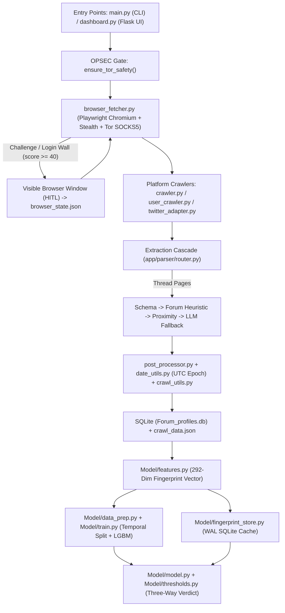

# MMFIC (Trowler) Documentation Wiki

**MMFIC (Multi-Modal Forum Identity Correlation)** is an Open Source Intelligence (OSINT) and cross-platform author attribution framework designed to collect posts from adversarial Clearnet platforms and Tor `.onion` forums and mathematically correlate pseudonyms across sites.

It consists of two integrated subsystems:
1. **Trowler (Data Acquisition & Parsing Engine):** A Playwright-based Stealth browser crawler routed over Tor SOCKS5 (`socks5h` DNS isolation) with Human-in-the-Loop (HITL) CAPTCHA handling, multi-tier DOM extraction, and OPSEC-gated LLM schema discovery.
2. **MMFIC Similarity Engine (Attribution & Correlation):** A self-supervised machine learning pipeline that builds 292-dimensional linguistic, behavioral, temporal, and topical author fingerprints stored in SQLite (`Forum_profiles.db`) and scores cross-forum identity pairs using LightGBM with a Three-Way Decision tie-breaker.

> **Legal & Ethical Notice:** Licensed under **GNU AGPLv3**. Operate only against authorized targets and in compliance with applicable laws and research ethics.

---

## Table of Contents

- [1. Architecture Overview](#1-architecture-overview)
- [2. Repository Layout](#2-repository-layout)
- [3. Prerequisites & Installation](#3-prerequisites--installation)
- [4. Configuration & OPSEC Guardrails](#4-configuration--opsec-guardrails)
- [5. Using the CLI (`main.py`)](#5-using-the-cli-mainpy)
- [6. Using the Web Dashboard (`dashboard.py`)](#6-using-the-web-dashboard-dashboardpy)
- [7. Crawling, HITL CAPTCHA & Parsing Pipeline](#7-crawling-hitl-captcha--parsing-pipeline)
- [8. Machine Learning & Identity Attribution (`Model/`)](#8-machine-learning--identity-attribution-model)
- [9. Database & Generated Runtime Files](#9-database--generated-runtime-files)
- [10. Dashboard REST API Reference](#10-dashboard-rest-api-reference)
- [11. Logging, Diagnostics & Verification](#11-logging-diagnostics--verification)
- [12. Troubleshooting & Known Limitations](#12-troubleshooting--known-limitations)
- [13. Contributing](#13-contributing)

---

## 1. Architecture Overview



---

## 2. Repository Layout

```text
Trowler-Nik/
├── main.py                     # Interactive CLI + --verbose / --debug flags
├── dashboard.py                # Localhost Flask web dashboard & REST API
├── requirements.txt            # Pinned direct dependencies (recommended cross-platform install)
├── requirements.lock           # Full transitive dependency snapshot
├── setup_and_install.bat       # Windows automated setup & launcher script
├── pyproject.toml              # Ruff / project configuration
├── .env.example                # Environment variable template
├── app/
│   ├── database.py             # SQLite initialization & posts/identity_pairs queries
│   ├── diagnostics.py          # Structured logging, FailureTracker, NaN guards, crawl callbacks
│   ├── crawler/
│   │   ├── browser_fetcher.py  # Playwright engine, Tor OPSEC checks, HITL CAPTCHA workflow
│   │   ├── crawler.py          # 2-level general forum crawler (index -> threads)
│   │   ├── user_crawler.py     # Targeted author profile/post crawler
│   │   ├── twitter_adapter.py  # X/Twitter DOM timeline scraper & HITL login integration
│   │   ├── link_extractor.py   # Thread & pagination link discovery
│   │   └── crawl_utils.py      # Shared deduplication, MIN_POST_WORDS=5, JSON/DB persistence
│   └── parser/
│       ├── router.py           # Extraction orchestrator (index & thread pipelines)
│       ├── known_schemas.json  # Built-in verified CSS selectors per domain
│       ├── schema_parser.py    # Cached/known CSS selector extractor
│       ├── forum_parser.py     # Generic forum & thread heuristic parser
│       ├── blog_parser.py      # Blog/listing adapter
│       ├── generic_parser.py   # Fallback content extractor
│       ├── proximity_parser.py # DOM structural proximity extractor
│       ├── classifier.py       # Page type classifier (forum/blog/listing/generic)
│       ├── llm_parser.py       # LiteLLM schema discovery, OPSEC gate, llm_audit.log
│       ├── post_processor.py   # Artifact cleaning (Dread/forum metadata, dedup, filtering)
│       └── date_utils.py       # Deterministic UTC English timestamp normalizer
├── Model/
│   ├── features.py             # 292-dimensional feature extractor & canonical feature names
│   ├── data_prep.py            # Chronological split & self-supervised pair builder
│   ├── model.py                # AuthorSimilarityModel (StandardScaler + LGBMClassifier)
│   ├── thresholds.py           # Canonical verdicts & decision boundaries
│   ├── fingerprint_store.py    # SQLite fingerprint caching, 1-vs-All & all-pairs comparison
│   └── train.py                # CLI training entrypoint (python -m Model.train)
├── scripts/
│   ├── prove_tor.py            # Verifies Tor SOCKS5 IP masking via httpbin.org
│   └── tor_manager.py          # Helper to spawn a local Tor daemon via stem (9050/9051)
├── templates/
│   └── index.html              # Single-page dashboard frontend (Vis.js identity graph)
└── static/                     # Dashboard static assets
```

---

## 3. Prerequisites & Installation

### Prerequisites
1. **Python 3.10+** (verified on Python 3.13; ensure `python` and `pip` match a single interpreter).
2. **Tor (Required for `.onion` and anonymous mode):**
   - **Tor Browser** running locally exposes SOCKS5 on `127.0.0.1:9150` and ControlPort on `9151` (default target in `app/crawler/browser_fetcher.py`).
   - **Tor Daemon / Expert Bundle** typically exposes SOCKS5 on `127.0.0.1:9050` and ControlPort on `9051`. If using a standalone `tor` service on port `9050`, update `TOR_PROXY` in `app/crawler/browser_fetcher.py` (or configure `TOR_CONTROL_PORT` in `.env` accordingly), or run Tor Browser alongside MMFIC.
3. **Optional Local LLM (Recommended for `.onion` OPSEC):**
   - [Ollama](https://ollama.com/) running at `http://localhost:11434` with a pulled model such as `llama3` (`ollama pull llama3`).

### Option A: Automated Windows Setup
Run `setup_and_install.bat` in the repository root. It checks for Python, creates `venv/`, installs `requirements.txt`, downloads Playwright Chromium, optionally prompts for a Gemini API key into `.env`, and lets you launch either the CLI or the Web Dashboard.

### Option B: Manual Setup (Linux / Kali / macOS / Windows)

```bash
# 1. Create and activate a fresh virtual environment on your target machine
python -m venv venv
source venv/bin/activate        # Windows PowerShell: .\venv\Scripts\Activate.ps1

# 2. Install Python dependencies
# Recommended cross-platform install (lets pip resolve OS/Python-specific deps like werkzeug & idna):
pip install --upgrade pip
pip install -r requirements.txt

# 3. Install Playwright's headless Chromium browser
playwright install chromium
# On headless Linux / Kali, install OS browser libraries if Playwright requests them:
# playwright install-deps chromium
```

> **Note on `requirements.lock` vs `requirements.txt`:**  
> `pip install --no-deps -r requirements.lock` provides bit-for-bit reproducible versions when targeting the exact Python 3.13 / Windows environment the lockfile was frozen from. On Linux, Kali, macOS, or Python 3.14+, **use `pip install -r requirements.txt`** instead so platform-specific transitive packages (`werkzeug`, `idna`, `charset-normalizer`, etc.) are resolved properly. Never copy a `venv/` folder across machines or operating systems.

### Verify Tor Routing Before Crawling

```bash
python scripts/prove_tor.py
```

`prove_tor.py` compares your direct public IP against `socks5h://127.0.0.1:9050` (and `192.168.1.40:9050` if configured). If you rely on Tor Browser (`9150`), start `dashboard.py` or `main.py`, which automatically checks `https://check.torproject.org/api/ip` over `127.0.0.1:9150`.

---

## 4. Configuration & OPSEC Guardrails

Copy `.env.example` to `.env` in the repository root:

```bash
cp .env.example .env
```

> **Important `.env` Formatting Warning:** `.env.example` contains inline notes (`\\ BAD OPSEC`) on the `ALLOW_CLOUD_LLM*` lines for visibility. Remove those `\\ ...` comments when editing your `.env` file so `python-dotenv` parses clean `true` / `false` boolean values.

### Environment Variables Reference

| Variable | Default | Purpose |
| :--- | :--- | :--- |
| `LLM_MODEL` | `ollama/llama3` | LiteLLM model identifier (e.g. `ollama/llama3`, `gemini/gemini-2.5-flash`, `gpt-4o-mini`, `claude-3-5-sonnet-20240620`). |
| `LLM_API_BASE` | `http://localhost:11434` (for `ollama/*`) | Custom API base URL passed to `litellm.completion()`. |
| `ALLOW_CLOUD_LLM` | `false` | Safety switch. Cloud models (`gemini/`, `gpt-`, `claude-`, etc.) are **blocked** unless set to `true`. |
| `ALLOW_CLOUD_LLM_FOR_ONION` | `false` | Secondary guardrail. Blocks sending `.onion` HTML/text to any cloud LLM unless explicitly set to `true`. |
| `HASH_EXTRACTED_USERNAMES` | `false` | If `true`, hashes usernames returned by LLM raw-text extraction to `anon_<10-hex-sha256>`. |
| `GEMINI_API_KEY` | *(unset)* | API key for `gemini/*` models via LiteLLM. |
| `OPENAI_API_KEY` | *(unset)* | API key for OpenAI `gpt-*` / `openai/*` models. |
| `ANTHROPIC_API_KEY` | *(unset)* | API key for Anthropic `claude-*` / `anthropic/*` models. |
| `DASHBOARD_API_TOKEN` | *(ephemeral random)* | Shared secret required in `X-API-Token` for all `/api/*` dashboard routes. |
| `CAPTCHA_TIMEOUT_SECONDS` | `3600` | Max seconds background dashboard crawls wait for HITL CAPTCHA resolution before aborting. |
| `TOR_CONTROL_PORT` | `9151` (or `9051`) | Stem `ControlPort` used for `Signal.NEWNYM` circuit rotation (`9151` if `9150` is in `TOR_PROXY`, else `9051`). |
| `TROWLER_VERBOSE` | `false` | Set `true`/`1` to enable `INFO`-level `trowler` logger output without passing `--verbose`. |
| `TROWLER_DEBUG` | `false` | Set `true`/`1` to enable `DEBUG`-level logging with full tracebacks. |

### How LLM Fallback & OPSEC Work (No Auto-Cloud Failover)
- **No silent cloud fallback:** If `LLM_MODEL` is set to local Ollama (`ollama/llama3`) and Ollama is not running, Trowler retries (`max_retries=2`), logs `[ERROR] trowler.llm_parser: LLM call exhausted ...`, and continues using deterministic non-LLM parsers — it **never** automatically falls back to Gemini, ChatGPT, or Claude.
- **To use a cloud LLM explicitly:** Set both `LLM_MODEL` (plus the provider API key) and `ALLOW_CLOUD_LLM=true` in `.env`. To allow cloud parsing on `.onion` targets (not recommended for sensitive investigations), you must also set `ALLOW_CLOUD_LLM_FOR_ONION=true`.
- **HTML redaction & audit trail:** During schema discovery, `_redact_text_nodes_for_schema` replaces post text nodes longer than 25 characters with `[REDACTED_CONTENT_<len>chars]` so only DOM tags/classes leave your machine. However, if all CSS selectors fail and the pipeline drops to `_llm_text_extract`, up to 5,000 characters of visible page text are sent. Every LLM attempt is recorded in `llm_audit.log` (`LOCAL` vs `CLOUD`, target URL, character count, and status).

### Network OPSEC Gate (`ensure_tor_safety`)
Before any crawl starts (CLI or Dashboard):
- If the target URL ends in `.onion` and Tor is disabled (`USE_TOR = False`) or unreachable, Trowler raises `TorOPSECError` and **refuses the crawl** to prevent local DNS leaks.
- Playwright Chromium is always launched with `--proxy-server=socks5://127.0.0.1:9150` and `--host-resolver-rules=MAP * ~NOTFOUND , EXCLUDE 127.0.0.1` so DNS resolution cannot bypass Tor.
- Requests (`check_tor`) use `socks5h://127.0.0.1:9150` for remote DNS resolution.

---

## 5. Using the CLI (`main.py`)

Start the interactive CLI:

```bash
python main.py               # Normal logging (WARNING+)
python main.py --verbose     # Detailed diagnostics (INFO+)
python main.py --debug       # Full tracebacks + DEBUG diagnostics
```

### Startup Tor Prompt
If `USE_TOR` is `True` and Tor fails the startup check, the CLI gives three safe choices:
- `[R]` Retry Tor connection check and provision a fresh circuit (`NEWNYM`).
- `[D]` Disable Tor for the current session (clearnet only; `.onion` URLs remain blocked).
- `[Q]` Quit immediately to preserve OPSEC.

### CLI Modes
1. **Mode 1 — General Forum Crawl:** Prompts for a starting index URL and runs a 2-level crawl (`max_index_pages=5`, `max_threads_per_page=10` default in `main.py`). Already-crawled URLs loaded from SQLite are skipped automatically, and thread order is shuffled to avoid linear bot patterns. Results persist to `Forum_profiles.db` and `crawl_data.json`.
2. **Mode 2 — User-Targeted Crawl:** Accepts either a direct profile link (auto-detecting the username for confirmation via `detect_profile_url` for `/u/`, `/user/`, `/profile/`, `/members/`, `/users/`, `/@`) or a base URL + target username, plus `max_pages` (default `30`). Saves to both `user_data_<username>.json`, `crawl_data.json`, and SQLite.
3. **Mode 3 — Identity Comparison Engine:**
   - `a.` List database profiles and compare two selected users 1-vs-1.
   - `b.` Compare one target user against **all** fingerprinted profiles in SQLite (`top_n=50`).
   - `c.` **Crawl & Compare:** Crawls a new target user, stores their fingerprint, and immediately compares 1-vs-1 or 1-vs-All.
   - `d.` Return to main menu.

> **CLI X/Twitter Crawling Note:** Currently, `dashboard.py` automatically dispatches `twitter.com` / `x.com` URLs to `crawl_twitter_user`. In `main.py`, Mode 1/2 call generic forum `crawl` / `crawl_user`; use the Web Dashboard (`dashboard.py`) for Twitter/X timeline acquisition.

---

## 6. Using the Web Dashboard (`dashboard.py`)

Launch the local web dashboard:

```bash
python dashboard.py [--verbose] [--debug]
```

Open `http://127.0.0.1:5000` in your browser.

### Security Model & Authentication
`dashboard.py` enforces strict local security controls:
- **Loopback-Only Bind:** Explicitly binds to `127.0.0.1:5000`. **Never bind to `0.0.0.0` or expose directly on a LAN/WAN.**
- **SSH Tunneling:** If running Trowler on a remote server, access it strictly via SSH local port forwarding:
  ```bash
  ssh -L 5000:127.0.0.1:5000 user@remote-host
  ```
- **Mandatory `X-API-Token`:** On startup, if `DASHBOARD_API_TOKEN` is not set in `.env`, an ephemeral random token is generated and printed to your local terminal. Paste that token into the **AUTHENTICATION REQUIRED** modal when opening the UI (or set a persistent `DASHBOARD_API_TOKEN` in `.env`).
- **Hardened Guards:**
  - `Origin` / `Referer` validation restricting API calls to `127.0.0.1`, `localhost`, or `::1`.
  - Sliding-window rate limiting (`60s` window): `15 req/min` for crawl/train/compare routes, `20 req/min` for user post/list lookups, `120 req/min` for status reads, and `10 failed auth attempts` -> `429` lockout.
  - Security headers on responses (`X-Content-Type-Options: nosniff`, `X-Frame-Options: DENY`, `Referrer-Policy: no-referrer`, `Cache-Control: no-store` on `/api/*`).
  - HTTP `500` responses never leak tracebacks or file paths to the browser; full exceptions print only to the server terminal.

### Web UI Views
- **Welcome Hub:** Quick-launch cards for General Crawl, User Crawl, and Identity Engine; live DB stats bar (`Platforms`, `Profiles`, `Posts`), Tor status indicator (`TOR ACTIVE` + exit IP or `CLEARNET / OFFLINE`), and model staleness warning banner if new posts were crawled since the last training run.
- **General Crawl & User Crawl:** Configure target URL, optional username, max index pages, and threads per page; monitor real-time post counters (`on_posts_found` callback — no fragile stdout scraping), tail logs, abort safely via `STOP CRAWL` (`stop_requested`), and trigger model training when a crawl completes.
- **Identity Engine Hub:**
  - **Browse Database:** Search/filter collected profiles grouped by forum and click to preview stored posts (`up to 50` per user).
  - **Pairwise Match:** Select User A and User B -> renders the animated 0–100% confidence gauge, canonical verdict badge (`MATCH`, `UNCERTAIN`, `MISMATCH`), scoring method/tie-breaker reason, and post counts.
  - **Identity Network Graph:** Interactive Vis.js correlation network (`default max_nodes=250`, hard cap `500`, max `2000` top edges) with adjustable score threshold and node physics stabilization.
  - **Crawl & Compare:** Crawls a new target directly from the Identity Hub, then lets you immediately compare the newly crawled profile.
- **HITL CAPTCHA Modal:** When Playwright detects an interactive challenge, Cloudflare/EndGame wait queue, or login wall (`captcha_pending`), the UI displays `ACTION REQUIRED` with three buttons:
  - **Resume Crawl:** Signals Trowler after you solve the challenge in the visible Chromium window.
  - **New Identity:** Deletes `browser_state.json`, requests a fresh Tor exit circuit (`NEWNYM`), and restarts the session.
  - **Stop & Save:** Saves collected posts and stops cleanly.

---

## 7. Crawling, HITL CAPTCHA & Parsing Pipeline

### Multi-Signal Challenge Detection & HITL Bypass
In `app/crawler/browser_fetcher.py`, `_score_challenge_signals` scores every loaded HTML response using weighted heuristics:
- `+40` password field with `< 80` visible words (`+35` if `< 200` words, `+25` otherwise)
- `+30` redirect to login/auth URL patterns (`/login`, `/signin`, `/flow/login`, `/auth`, etc.)
- `+15` low content density (`< 200` words without password field)
- `+30` challenge keywords in first 2,000 bytes (`captcha`, `ddos-guard`, `cloudflare`, `endgame`, `just a moment`, `placed in a queue`, `session expired`, `bot-like behavio`, etc.)
- `+5` OAuth/SSO iframe markers (Clearnet only)

If `score >= 40`:
1. Optional LLM false-positive check (`_llm_text_extract`): if valid posts can already be read, HITL is skipped.
2. Otherwise, Playwright closes headless mode and spawns a **visible Chromium window** (`headless=False`) loaded with any prior cookies so the analyst can solve the CAPTCHA, wait queue, or login wall manually.
3. Cookie/storage state is persisted to `browser_state.json`, the visible browser closes, and scraping resumes seamlessly in headless mode.
4. If the site returns a session-terminated page (`SessionExpired`), `crawler.py` (up to `5` renewals) and `user_crawler.py` (up to `3` renewals) automatically wipe `browser_state.json`, rotate the Tor circuit via `stem`, and continue from unvisited pages.

### Twitter / X Adapter (`app/crawler/twitter_adapter.py`)
- Automatically invoked by `dashboard.py` for `twitter.com`, `x.com`, `mobile.twitter.com`, or `mobile.x.com` URLs.
- Scrolls timelines collecting original posts via stable `[data-testid="tweet"]` and `[data-testid="tweetText"]` selectors (filtering out retweets) while tracking extraction failure rates.
- On the first run, the X/Twitter login wall triggers the HITL visible browser; once logged in (use a dedicated research account), `browser_state.json` persists the session across subsequent headless crawls.

### Multi-Tier Extraction Cascade (`app/parser/router.py`)
- **Index Pages:** Raw JSON API detection -> `classify_page()` -> `parse_forum()` / `parse_blog()` / `parse_generic()` -> `post_process()`. No LLM calls are spent on index pages.
- **Thread Pages (Waterfall):**
  0. **Schema Parser (`schema_parser.py`):** Checks bundled `app/parser/known_schemas.json` (`www.reddit.com`, Tenebris `.onion`, Dread `.onion`) plus runtime `schema_cache.json`.
  1. **Manual Forum Parser (`forum_parser.py`):** CSS-class/HTML heuristics for common forum engines.
  2. **Proximity Parser (`proximity_parser.py`):** Structural DOM proximity grouping when classes are obfuscated.
  3. **LLM Fallback (`llm_parser.py`):** Only triggered when extracted posts `< 2` or `real_usernames == 0`, and skipped if `LLMOpsecBlocked` or JS-rendered SPA shell detected. Checks domain cache -> SHA-256 DOM structural hash cache (`structural_cache.json`) -> LLM CSS schema discovery -> raw text extraction fallback.
- **Post-Processing & Time Normalization:** Cleans forum badges/footer artifacts (`post_processor.py`), enforces minimum substance (`MIN_POST_WORDS = 5` in `crawl_utils.py`), deduplicates using MD5 prefixes, and parses English relative/absolute timestamps deterministically in UTC (`date_utils.py`).

---

## 8. Machine Learning & Identity Attribution (`Model/`)

### 292-Dimensional Feature Vector (`Model/features.py`)
Every fingerprinted user profile (`CANONICAL_FEATURE_DIM = 292`) combines six behavioral and linguistic signal families:

| Group | Dims | Features |
| :--- | :---: | :--- |
| **Stylometric** | `16` | Average/std word length, average/std sentence length, Type-Token Ratio (TTR), Hapax Legomena ratio, punctuation rates (`,`, `.`, `!`, `?`, `...`), uppercase & capitalized word ratios, paragraph length, words & unique words per sentence. |
| **Lexical** | `212` | `136` unconscious function words + `68` internet/OSINT slang markers (`opsec`, `fud`, `lol`, `tbh`, etc.) + `8` structural stats (`slang_total_rate`, `digit_rate`, `url_rate`, `emoji_rate`, `quote_rate`, `contraction_rate`, `avg_freq_rank`, `bigram_richness`). |
| **Behavioral** | `10` | Post count, mean/std/median post length, short/long post ratios, length coefficient of variation, chars/word, mean inter-post delay, posting velocity. |
| **Timeprint** | `24` | Normalized 24-hour UTC circadian posting distribution (`tp_hour_00`..`tp_hour_23`). |
| **Subforum** | `10` | Relative frequency distribution across the top-10 `board_vocab` URL path segments (`board_*`). |
| **LDA Topics** | `20` | `LatentDirichletAllocation` (`n_components=20`) topic mixture (`lda_topic_0`..`lda_topic_19`). |

Non-finite feature entries (`NaN`/`Inf`) are logged with counts and sample indices via `sanitize_finite_array()` before scaling or distance calculation.

### Self-Supervised Temporal Training (`Model/data_prep.py` & `Model/train.py`)
MMFIC trains **without requiring manual ground-truth identity labels**:
1. Posts are grouped by composite key `username@domain` (`"admin"` on Forum A and `"admin"` on Forum B stay separate profiles; `"unknown"` and posts with `< 5` words are excluded). Profiles must have `>= 3` substantial posts.
2. Each eligible user's posts are split into two halves (`_split_posts`):
   - **Chronological split (preferred):** When `>= 2` distinct valid UTC timestamps cover at least half of a user's posts, posts are sorted chronologically and split at the median to capture realistic temporal drift.
   - **Seeded shuffle fallback:** Used when timestamps are absent or identical (`--seed 42`).
3. **Training pairs (`X = |feat_A - feat_B|`):**
   - **Positive (`1`):** Same user's earlier half vs. later half.
   - **Negative (`0`):** Different users' halves sampled at `neg_ratio` (default `3` negatives per positive).
4. Trains `StandardScaler` + `LGBMClassifier` (`n_estimators=200`, `max_depth=6`, `learning_rate=0.1`, `is_unbalance=True`, `random_state=42`) with up to 5-fold stratified cross-validation (`roc_auc` & `accuracy`).

**CLI Training Command:**
```bash
python -m Model.train --data crawl_data.json --neg 3 --seed 42 --lda-topics 20
```
Outputs artifacts into `Model/`:
- `trained_model.joblib`, `scaler.joblib`, `lda_model.joblib`, `lda_vectorizer.joblib`, `board_vocab.joblib`, `model_meta.json`.

### Canonical Three-Way Decision Logic (`Model/thresholds.py`)
All CLI, Dashboard, and Fingerprint Store comparisons share a single server-side decision standard:

- `score >= 0.80` (`MATCH_THRESHOLD`) -> **`MATCH`** (`CONFIDENT MATCH`)
- `score <= 0.30` (`MISMATCH_THRESHOLD`) -> **`MISMATCH`** (`LIKELY DIFFERENT`)
- `0.30 < score < 0.80` -> Evaluated by the **Subforum & Timeprint Tie-Breaker** (indices `238:272` in the difference vector, `COSINE_TIE_BREAKER = 0.85`):
  - Low behavioral/temporal divergence (`magnitude < 0.75`) with `score > 0.5` -> promoted to **`MATCH`**.
  - High divergence (`magnitude > 2.0`) -> demoted to **`MISMATCH`**.
  - Otherwise remains **`UNCERTAIN`**.

If no trained LightGBM model exists on disk, scoring gracefully falls back to **Cosine Similarity** over the 292-dimensional fingerprint vectors.

---

## 9. Database & Generated Runtime Files

### SQLite Schema (`Forum_profiles.db`)
Managed across `app/database.py` and `Model/fingerprint_store.py` (with `PRAGMA journal_mode=WAL`):
- `posts`: `id`, `forum`, `username`, `content`, `timestamp` (UTC integer epoch once normalized), `url`, `crawled_at`.
- `identity_pairs`: `id`, `username_a`, `forum_a`, `username_b`, `forum_b`, `same_person` (`1`/`0`/`NULL`), `confidence` (`'manual'`/`'inferred'`/`'auto'`).
- `fingerprints`: `id`, `username`, `forum`, `fingerprint` (JSON 292-float array), `post_count`, `total_words`, `first_seen`, `last_updated` (`UNIQUE(username, forum)`).
- `training_log`: `id`, `trained_at`, `n_users`, `n_posts_total`, `n_pairs`, `n_positive`, `n_negative`, `cv_roc_auc`, `cv_accuracy`, `train_roc_auc`, `model_version`.
- `similarity_results`: `id`, `username_a`, `forum_a`, `username_b`, `forum_b`, `score`, `computed_at`, `model_version` (`UNIQUE` on pair).

### Sensitive / Local Runtime Files (Never Commit to Git)
- `.env`: API keys, `DASHBOARD_API_TOKEN`, and OPSEC settings.
- `Forum_profiles.db` / `*.db-journal`: Collected OSINT corpus and fingerprints.
- `crawl_data.json` / `user_data_*.json`: Exported crawl datasets.
- `browser_state.json`: Authenticated session cookies (e.g., Twitter/X or solved forum sessions).
- `schema_cache.json` & `structural_cache.json`: Auto-discovered CSS selectors and structural hashes.
- `llm_audit.log`: Audit log of every LLM call, provider, target URL, and character count.
- `Model/*.joblib` & `Model/model_meta.json`: Trained local ML model weights and training timestamps.

---

## 10. Dashboard REST API Reference

All `/api/*` endpoints require header `X-API-Token: <token>` and loopback `Origin`/`Referer` when present.

| Method | Endpoint | Rate Tier | Description |
| :--- | :--- | :--- | :--- |
| `GET` | `/` | Standard | Serves the single-page web UI (`templates/index.html`). |
| `GET` | `/api/stats` | Standard (`120/m`) | DB platform/profile/post counts + `model_trained` & `model_stale` flags. |
| `GET` | `/api/tor/status` | Standard (`120/m`) | Tor active boolean, `is_tor`, exit `ip`, and `mode` (`?force=true` bypasses 15s cache). |
| `GET` | `/api/users` | Standard (`120/m`) | All users grouped by forum with post counts. |
| `GET` | `/api/users/<forum>` | Lookup (`20/m`) | Users and post counts for a single forum. |
| `GET` | `/api/user/<username>/<forum>/posts` | Lookup (`20/m`) | Up to 50 stored posts for the requested user/forum (`404` if missing). |
| `POST` | `/api/crawl/general` | Heavy (`15/m`) | Starts background general crawl (`url`, `max_pages`, `max_threads`); auto-routes X/Twitter. |
| `POST` | `/api/crawl/user` | Heavy (`15/m`) | Starts background user-targeted crawl (`url`, `username`, `max_pages`). |
| `GET` | `/api/crawl/status` | Standard (`120/m`) | Crawl running flag, status, `posts_found`, `elapsed_seconds`, last 5 log lines. |
| `POST` | `/api/crawl/captcha_action` | Standard (`120/m`) | Submits HITL CAPTCHA choice (`"resume"`, `"new"`, or `"exit"`) when `captcha_pending`. |
| `POST` | `/api/crawl/stop` | Standard (`120/m`) | Cooperatively signals `stop_requested` so crawler closes cleanly on owning thread. |
| `POST` | `/api/compare/pair` | Heavy (`15/m`) | Scores `user_a`@`forum_a` vs `user_b`@`forum_b`; returns `score`, `verdict`, `meta`, thresholds. |
| `POST` | `/api/compare/all` | Heavy (`15/m`) | Syncs missing fingerprints (up to 100 per call) and returns `top_n` matches. |
| `GET` | `/api/compare/graph` | Standard (`120/m`) | Builds Vis.js nodes & edges (`?threshold=0.50`, `?max_nodes=250`, hard cap `500` nodes / `2000` edges). |
| `GET` | `/api/model/status` | Standard (`120/m`) | Returns `is_trained`, `is_stale`, `last_trained`, `training_in_progress`. |
| `GET` | `/api/model/importances` | Standard (`120/m`) | Top 30 LightGBM feature importances mapped to exact 292-dim feature names. |
| `POST` | `/api/model/train` | Heavy (`15/m`) | Launches background model training (`{"lda_topics": 20}`) and rebuilds fingerprints. |
| `GET` | `/api/model/train/status` | Standard (`120/m`) | Training progress state, status stage, error flag, and metrics. |

---

## 11. Logging, Diagnostics & Verification

### Verbosity & Failure Counters
- Pass `-v` / `--verbose` (`INFO`) or `--debug` (`DEBUG` + stack traces) to `main.py`, `dashboard.py`, or `Model/train.py`, or set `TROWLER_VERBOSE=true` / `TROWLER_DEBUG=true`.
- Structured warnings (`[WARNING] trowler.*`) report timestamp parsing failure counts/samples (`date_utils.py`), thread/index fetch failure ratios (`crawler.py`), skipped malformed tweet DOM nodes (`twitter_adapter.py`), LLM retry exhaustion (`llm_parser.py`), and masked non-finite vector entries (`diagnostics.py`).

### Linting (CI Standard)
The repository enforces Ruff linting via `.github/workflows/lint.yml`:
```bash
ruff check .
```

---

## 12. Troubleshooting & Known Limitations

- **`ModuleNotFoundError: No module named 'werkzeug'` or `'idna'` on fresh Linux/Kali:**
  Caused by running `pip install --no-deps -r requirements.lock` on a different OS or Python minor version than the lockfile origin (or copying a `venv/` folder). Recreate the virtual environment cleanly on the target machine and run `pip install -r requirements.txt` followed by `playwright install chromium`.
- **`CRITICAL OPSEC VIOLATION` / Tor Unreachable on Startup:**
  Confirm Tor Browser (`127.0.0.1:9150`) is open and connected, or if using system `tor` daemon (`127.0.0.1:9050`), run `python scripts/tor_manager.py` / start the `tor` service and ensure `TOR_PROXY` in `app/crawler/browser_fetcher.py` matches your SOCKS5 port.
- **`.onion` Timeouts (`ERR_TIMED_OUT`):**
  Darkweb services frequently experience heavy load or DDoS pressure. Playwright navigation timeout is set to `180s` (`180000ms`), and transient failures apply exponential backoff with `NEWNYM` circuit rotation. Re-running later automatically skips already-saved URLs in SQLite.
- **`[OPSEC ALERT] Cloud LLM call ... blocked`:**
  By design, cloud providers (`gemini/`, `gpt-*`, `claude-*`) are denied unless `ALLOW_CLOUD_LLM=true` (and `ALLOW_CLOUD_LLM_FOR_ONION=true` for `.onion` sites) is explicitly enabled in `.env`. Run local Ollama (`ollama/llama3`) to analyze hidden services completely offline.
- **Twitter/X Login Wall & Large Single Page Applications (SPAs):**
  LLM raw-text fallback truncates visible text at 5,000 characters, which is insufficient on massive React/Ember SPAs. Twitter/X is handled explicitly by `twitter_adapter.py` using CSS `data-testid` selectors plus HITL cookie persistence (`browser_state.json`).
- **Low Cross-Validation Score / Small Dataset Warning:**
  Training requires at least 2 distinct `username@domain` profiles having `>= 3` substantial posts (`>= 5` words each). Small datasets yield noisy CV ROC-AUC scores; gather more posts per target or adjust `--neg` before relying on automated attributions.

---

## 13. Contributing

MMFIC is released under **AGPLv3**. If you deploy or build derivative threat-intelligence services using this code, you must make your modified source code available under AGPLv3.

When contributing new forum or social adapters:
1. Route all network fetches through `app/crawler/browser_fetcher.py` (`fetch_page`, `ensure_tor_safety`) — never bypass Tor with raw `requests` or local DNS lookups.
2. Report new post counts via `notify_posts_found()` and log recoverable extraction failures via `app.diagnostics.log_failure()`.
3. Run `ruff check .` before submitting pull requests.
